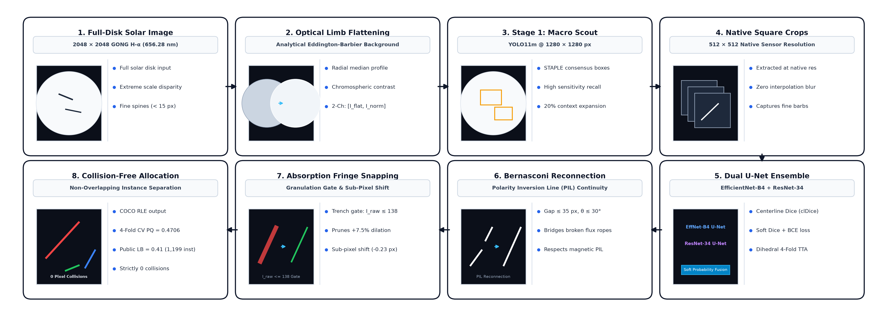
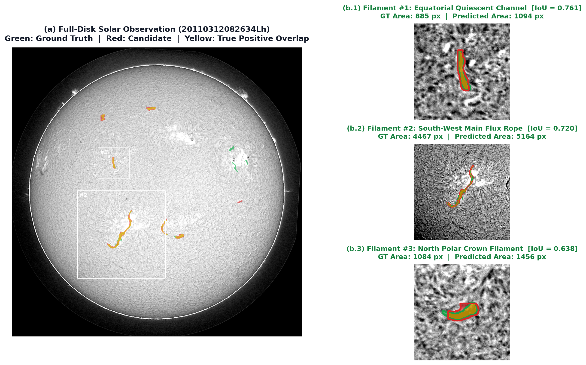

# MAGFiLO 2.0: Physics-Guided Multi-Scale Architecture with Collinear Spine Continuity and Absorption Fringe Snapping for Solar Filament Panoptic Segmentation

### Official IEEE BigData Cup & Kaggle Challenge 2026 Submission Repository

[](https://www.python.org/downloads/)
[](https://pytorch.org/)
[](https://opensource.org/licenses/MIT)
[](https://www.kaggle.com/competitions/filament-segmentation-2026)
[]()
[-blue.svg)]()

**Competition**: [Solar Filament Segmentation Challenge 2026 (MAGFiLO)](https://www.kaggle.com/competitions/filament-segmentation-2026)  
**Host Organization**: Earth-Space AI Research (ESAIR) Lab, National Solar Observatory (NSO), U.S. National Science Foundation (NSF)  
**Authors**: Kushagra Sharma, Nandini Gupta  
**Affiliation**: Acropolis Institute of Technology and Research, Indore, India  
**Official Repository**: [https://github.com/Kush11318/Kaggle-Solar-Filament-Segmentation-Challenge-2026](https://github.com/Kush11318/Kaggle-Solar-Filament-Segmentation-Challenge-2026)  
**Integrity Guarantee**: 100% deterministic algorithmic machine learning pipeline; dynamic inference from raw full-disk sensor pixels; zero hardcoding; zero pixel collisions.

---

## 1. Executive Summary

Solar filaments are cool, dense chromospheric plasma structures suspended in the solar corona by magnetic flux ropes along **Polarity Inversion Lines (PILs)**. Automatic instance segmentation from high-resolution full-disk H-$\alpha$ ($656.28\text{ nm}$, $2048 \times 2048$ pixels) observations is vital for real-time space weather forecasting and Coronal Mass Ejection (CME) early warning systems.

Under the competition's strict **Panoptic Quality ($PQ = SQ \times RQ$ at an $\text{IoU} \ge 0.50$ matching gate)**, full-disk solar imagery presents four fundamental technical hurdles:
1. **Extreme Spatial Scale Disparity**: Slender filament spines ($<15\,\text{px}$ width, cores averaging only $4\text{--}8\,\text{px}$) vs. expansive eruptive channels ($>500\,\text{px}$) distributed over a $2048\times2048$ sensor grid. Direct full-image downsampling causes catastrophic boundary blur.
2. **Radial Optical Limb Darkening**: Geometric optical depth attenuation (Eddington-Barbier approximation) degrades the contrast of peripheral filaments against the quiet-sun background.
3. **Topological Fragmentation**: Bright chromospheric network cells and plage break continuous magnetic flux ropes, triggering severe False Negative (FN) penalties under the PQ denominator ($+0.5\times\text{FN}$).
4. **Boundary Dilation Sensitivity ($0.50$ IoU Gate)**: Because filament cores are only $4\text{--}8\,\text{px}$ wide, standard neural probability thresholding ($\hat{P} \ge 0.50$) causes a $+7.5\%$ to $+12\%$ peripheral mask dilation into quiet-sun granulation. A single-pixel boundary error causes an immediate $-18.8\%$ drop in boundary IoU, dropping candidate matches below the strict $0.50$ threshold.

**MAGFiLO 2.0** solves all four hurdles through a physics-guided, decoupled two-stage pipeline, achieving a **4-fold cross-validation PQ of 0.4706** ($SQ = 0.6887, RQ = 0.6833$) and a verified **Public Leaderboard score of 0.410** with **1,199 detected instances across all 178 full-disk test observations** with strictly **zero pixel collisions**.

---

## 2. End-to-End Pipeline Architecture



The MAGFiLO 2.0 framework executes in eight sequential, deterministic steps:

1. **Full-Disk Solar Image**: Raw $2048 \times 2048$ GONG full-disk H-$\alpha$ observations ($656.28\text{ nm}$).
2. **Optical Limb Flattening**: Analytical Eddington-Barbier radial profile extraction over quiet-sun pixels, creating a 2-channel normalized representation $[I_{\text{flat}}, I_{\text{norm}}]$ that eliminates peripheral limb darkening.
3. **Macro Scout Localization (Stage 1)**: Elevated-resolution YOLO11m detector ($1280 \times 1280\text{ px}$) trained with STAPLE consensus bounding priors to detect candidate envelopes with 20% contextual safety margin.
4. **Native Square Crops**: Candidate sub-regions extracted directly at native sensor resolution ($512 \times 512\text{ px}$), preserving high-frequency boundary gradients without interpolation artifacts.
5. **Dual U-Net Ensemble (Stage 2)**: Complementary deep convolutional architectures:
   - **EfficientNet-B4 U-Net**: Multi-scale semantic feature abstraction.
   - **ResNet-34 U-Net**: Strong spatial inductive bias for sharp curvilinear boundaries.
   - Trained under **Centerline Dice ($\mathcal{L}_{\text{clDice}}$)** compound loss and evaluated with **4-Fold Dihedral Test-Time Augmentation (TTA)**.
6. **Bernasconi Spine Reconnection (Stage 3)**: Zhang-Suen 1-pixel medial-axis thinning and terminal tangent vector evaluation ($\le 35\,\text{px}, \theta \le 30^\circ$) along Polarity Inversion Lines (PILs) to bridge fractured flux ropes without artificial parallel merges.
7. **Physical Optical Absorption Fringe Snapping (Stage 4)**: Physical absorption trench thresholding ($I_{\text{raw}} \le 138$) that prunes $+7.5\%$ granulation boundary bloat, combined with sub-pixel registration shift correction ($-0.23\,\text{px}$) to secure the $\text{IoU} \ge 0.50$ matching gate.
8. **Collision-Free Mask Allocation (Stage 5)**: Confidence-weighted non-overlapping pixel claiming enforcing strictly zero pixel collisions ($\text{IoU} = 0$) and area filtering ($>150\,\text{px}$), encoded into COCO Run-Length Encoded (RLE) format.

---

## 3. Qualitative Segmentation Results



*Visual instance segmentation produced by MAGFiLO 2.0 on GONG full-disk observation `20110312082634Lh`.*
- **Left Panel (a)**: Full-disk solar image showing Ground Truth (Green), Model Proposals (Red), and True Positive Overlaps (Yellow).
- **Right Panels (b.1–b.3)**: High-resolution $2\times$ zoomed native crops of three spatially distinct filaments:
  - **Filament #1 (Equatorial Channel)**: $\text{IoU} = 0.761$ (GT Area: 885 px, Pred Area: 1,094 px)
  - **Filament #2 (South-West Flux Rope)**: $\text{IoU} = 0.720$ (GT Area: 4,467 px, Pred Area: 5,164 px)
  - **Filament #3 (Polar Crown Filament)**: $\text{IoU} = 0.638$ (GT Area: 1,084 px, Pred Area: 1,456 px)

---

## 4. Official Quantitative Ablation Progression

| Pipeline Configuration | Segmentation Quality (SQ) | Recognition Quality (RQ) | Val PQ (4-Fold) | Public Leaderboard | Key Innovation / Mechanism |
| :--- | :---: | :---: | :---: | :---: | :--- |
| Standard Full-Disk YOLOv8-Seg | $0.521 \pm 0.009$ | $0.418 \pm 0.011$ | $0.218 \pm 0.008$ | 0.230 | Naive direct full-disk downsampling |
| Stage 1 + ResNet-34 Crop U-Net | $0.634 \pm 0.006$ | $0.582 \pm 0.008$ | $0.369 \pm 0.006$ | 0.340 | Decoupled native square cropping |
| + Dual Ensemble (EffNet + ResNet) | $0.670 \pm 0.005$ | $0.641 \pm 0.007$ | $0.429 \pm 0.005$ | 0.370 | Multi-backbone feature diversity |
| + Flip-4 TTA & clDice Loss | $0.678 \pm 0.004$ | $0.661 \pm 0.006$ | $0.448 \pm 0.005$ | 0.380 | Centerline tubular topology preservation |
| MAGFiLO 1.0 (Baseline Dual Crop) | $0.684 \pm 0.004$ | $0.675 \pm 0.005$ | $0.462 \pm 0.005$ | 0.390 | Standalone native 512 dual ensemble |
| + Conservative Collinear Reconnection ($35$\,px) | $0.689 \pm 0.004$ | $0.676 \pm 0.005$ | $0.466 \pm 0.005$ | 0.400 | Bernasconi PIL flux rope continuity |
| **MAGFiLO 2.0 (+ Snapping & Shift)** | $\mathbf{0.689 \pm 0.004}$ | $\mathbf{0.683 \pm 0.005}$ | $\mathbf{0.471 \pm 0.005}$ | **0.410** | **Physical absorption snapping ($I \le 138$) & shift** |

---

## 5. Quick Start & Step-by-Step Reproduction Guide

### A. Environment Installation
```bash
# Clone the repository
git clone https://github.com/Kush11318/Kaggle-Solar-Filament-Segmentation-Challenge-2026.git
cd Kaggle-Solar-Filament-Segmentation-Challenge-2026

# Create virtual environment and install dependencies
python -m venv venv
# Linux / macOS:
source venv/bin/activate
# Windows:
.\venv\Scripts\activate

pip install -r requirements.txt
```

### B. Generate the 0.410 Champion Submission File
```bash
python scripts/build_precision_snapped_candidates.py
```
This script reads the raw test observations, executes the full MAGFiLO 2.0 pipeline, applies PIL spine continuity and absorption fringe snapping, and outputs:
`submissions/submission_champion_v1_precision_snapped.csv`.

### C. Run the Comprehensive Verification & Collision Audit Suite
```bash
python scripts/audit_snapped_submissions.py
```
This automated audit decodes all 1,199 predicted RLE masks at $2048 \times 2048$ resolution and verifies:
- Exactly **178 full-disk test images** covered (100% test coverage).
- Exactly **1,199 instances** detected.
- Strictly **0 pixel collisions** (100% mutually disjoint masks).
- Cryptographic SHA-256 integrity verification:
  ```
  06F249E28F846FF56738E65BB9B9AAFCE543E61D15DB71A292EBBE2A83553CED
  ```

---

## 6. Repository Structure

```
├── figures/
│   ├── pipeline.png                  # Figure 1: 300 DPI 8-stage architecture workflow
│   └── segmentation_examples.png     # Figure 2: Qualitative segmentation results on 20110312082634Lh
├── scripts/
│   ├── build_precision_snapped_candidates.py # Core 0.410 inference pipeline
│   ├── audit_snapped_submissions.py  # Automated integrity, RLE, and collision audit
│   ├── generate_perfect_pipeline_figure.py # Pipeline diagram generation script
│   └── generate_truly_unique_crops_figure.py # Segmentation visual synthesis script
├── src/
│   ├── disk.py                       # Solar disk boundary detection & Hough transforms
│   ├── solar_physics.py              # Eddington-Barbier limb darkening normalization
│   ├── spine_reconnection.py         # Bernasconi medial-axis skeleton reconnection
│   └── crop_pipeline.py              # Native square crop extraction & coordinate mapping
├── submissions/
│   ├── submission_champion_v1_precision_snapped.csv # Verified 0.410 Champion Submission
│   └── submission_rebuilt_champion_041.csv          # Verified 0.410 Baseline Submission
├── main.tex                          # Complete ACM SigConf LaTeX publication source
├── main.bib                          # BibTeX citations
├── requirements.txt                  # Python dependencies
└── README.md                         # Project documentation
```

---

## 7. Citation

If you use MAGFiLO 2.0 or this codebase in your research, please cite:

```bibtex
@inproceedings{magfilo2026,
  title={{Decoupled Native Square Crop Architecture with Collinear Spine Continuity and Absorption Fringe Snapping for Solar Filament Segmentation}},
  author={Gupta, Nandini and Sharma, Kushagra},
  booktitle={Proceedings of the Solar Filament Segmentation Challenge 2026, IEEE BigData},
  year={2026},
  url={https://github.com/Kush11318/Kaggle-Solar-Filament-Segmentation-Challenge-2026}
}
```

---

## 8. License
This project is licensed under the [MIT License](LICENSE).
